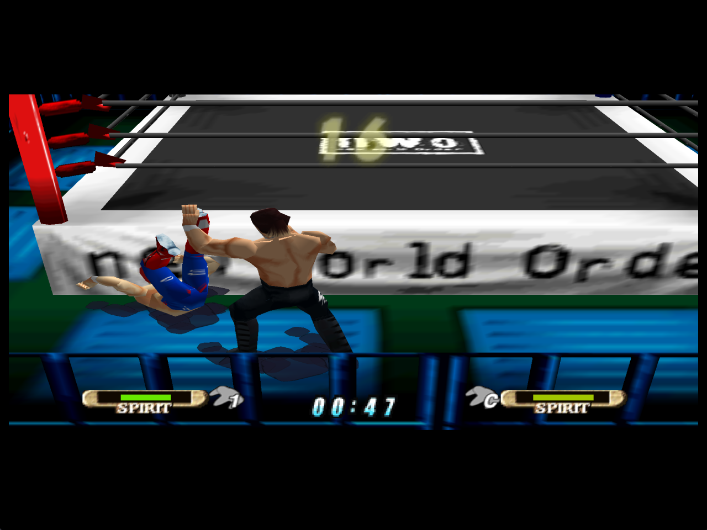
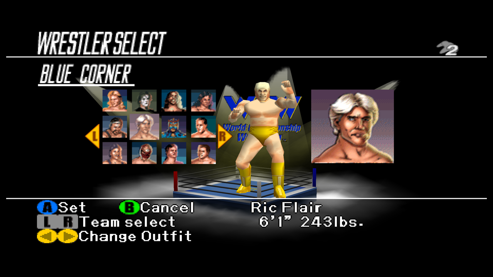
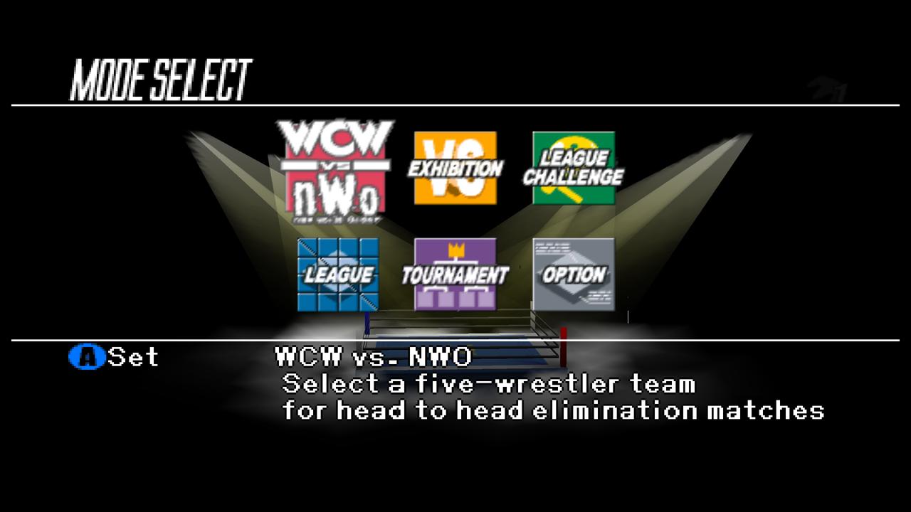

# WCW vs. nWo World Tour: Recompiled

WCW vs. nWo World Tour: Recompiled is a project that uses
[N64Recomp](https://github.com/N64Recomp/N64Recomp) to **statically recompile** the
Nintendo 64 game *WCW vs. nWo World Tour (USA)* into a native PC port, running on the
[N64ModernRuntime](https://github.com/N64Recomp/N64ModernRuntime) with
[RT64](https://github.com/rt64/rt64) as the rendering engine.

### **This repository and its releases do not contain game assets. The original game is required to build or run this project.**

> **Status: beta.** The game is fully playable end to end — boots, renders, full
> matches with sound, keyboard + gamepad input, menus, local multiplayer, rumble, and
> persistent saves. See [Known Issues](#known-issues) for what's still rough.

<div align="center">
  
  <br>
  
  
</div>

## Table of Contents
* [System Requirements](#system-requirements)
* [Features](#features)
  * [Plug and Play](#plug-and-play)
  * [Fully Intact N64 Effects](#fully-intact-n64-effects)
  * [Local Multiplayer for up to 4 Players](#local-multiplayer-for-up-to-4-players)
  * [Widescreen Support](#widescreen-support)
  * [Easy-to-Use Menus](#easy-to-use-menus)
  * [Controls Tailored to This Game](#controls-tailored-to-this-game)
  * [Saves and Rumble Without Pak Juggling](#saves-and-rumble-without-pak-juggling)
* [Compared with Emulation](#compared-with-emulation)
* [Planned Features](#planned-features)
* [FAQ](#faq)
* [Known Issues](#known-issues)
* [Lighting](#lighting-ray-tracing)
* [Mods and ROM Hacks](#mods-and-rom-hacks)
* [Building](#building)
* [Libraries Used and Projects Referenced](#libraries-used-and-projects-referenced)
* [Special Thanks](#special-thanks)

## System Requirements

Currently a **Windows** build is provided; other operating systems may be supported
later.

A GPU supporting Direct3D 12.0 (Shader Model 6) or Vulkan 1.2 is required. A CPU
supporting the SSE4.1 instruction set is also required (Intel Core 2 Penryn series or
AMD Bulldozer and newer).

If you have crashes on startup, make sure your graphics drivers are fully up to date.

## Features

#### Plug and Play

Provide your copy of the US version of the game and start playing! The project loads
assets directly from your ROM, so there is no separate extraction or build step.

#### Fully Intact N64 Effects

Rendering is hardware-accelerated through RT64 at high resolution, with the game's
original visual effects intact — no emulator-style workarounds or hacks.

#### Local Multiplayer for up to 4 Players

Plug in up to four controllers and each pad is automatically assigned to the next free
player — no setup needed. The keyboard always drives player 1 by default, and a
player-assignment menu is available for custom arrangements (e.g. keyboard as player 2).

#### Widescreen Support

With Aspect Ratio set to **Expand** (the default), the 3D scene renders at your
window's aspect ratio with a correctly widened field of view, while 2D interface
elements stay at their original proportions.

#### Easy-to-Use Menus

Press Esc (or your gamepad's Back/Select button) during play to open the config menu:
general settings, graphics settings, full input rebinding for keyboard and controller
(two bindings per input), and audio settings. Menus can be used with mouse, keyboard,
or controller.

#### Controls Tailored to This Game

World Tour moves on the N64 **d-pad** and taunts with the analog stick, so the default
mappings are built for that: move on the left stick *and* d-pad, taunt on the right
stick, and the defensive pair on mirrored triggers (duck = left trigger, block = right
trigger). Grapple = A, attack = X, run = B, climb/turnbuckle = Y, switch focus =
bumpers. Keyboard: WASD moves, IJKL taunts, Space/Shift/Q/E/R for the face buttons.
Everything is rebindable in the in-game menu.

#### Saves and Rumble Without Pak Juggling

On real hardware this game saves **only** to a Controller Pak and rumbles **only**
with a Rumble Pak — one slot, physically swapped. The port emulates a hybrid pak:
saves always work and persist automatically, and if you answer the game's "Insert a
Rumble Pak now" prompt at the title screen, rumble works too, with no risk to your
save data. In multiplayer, players 2-4 get a Rumble Pak in their own port too, so
every player's gamepad rumbles.

#### Smoother Motion (Experimental)

Settings → Graphics → **Framerate** offers 30 (Original), 60 (Smooth) and 120 (Experimental). The extra frames
are generated by frame interpolation, so the game itself still runs at its original speed.

#### Ray Tracing and Venue Lighting (Experimental)

With **Ray Tracing** on, the arena lights cast real shadows (replacing the game's blob shadows) and ambient
occlusion darkens the places where surfaces meet. **Ray Tracing Quality** goes from Performance to Ultra. Every
venue has its own lighting rig: colored light, glowing screens and lamps, and the lighting follows the camera
cuts. This release rigs the four arena themes (the WCW arena, the nWo arena, the DOA arena and the IU gym hall). You can change the lighting yourself: see [Lighting](#lighting-ray-tracing).
Needs the D3D12 graphics API and a GPU with DirectX Raytracing 1.1 (RTX-class).

#### CRT Filter (Experimental)

**CRT Filter** simulates a period TV: the video signal (Composite, S-Video, RF or RGB), scanlines, phosphor mask
and glow, with USA or Japan **TV Colors**. The optional **CRT Beam Simulator** recreates the CRT's rolling scan for
motion clarity (needs V-Sync and a 120 Hz or faster display).

#### HDR (Experimental)

**HDR** outputs in HDR on displays with Windows HDR turned on. **HDR Picture** picks how bright the game's white
is: **Auto** (the default) suits your display, matching your desktop, or with the CRT filter on, leaving enough
headroom for a full-strength phosphor mask. **Brighter**, **Balanced**, **CRT Detail** and **Custom** (in nits)
are there if you prefer something else, and the setting's description shows your display's brightness and what
your choice gives.

#### Mods

The **Mods** menu (Settings → Mods) installs, configures and switches mods on and off. A free camera, cheats and a
Quick Match testing tool come bundled; see [Mods and ROM Hacks](#mods-and-rom-hacks).

## Compared with Emulation

What the port takes care of that emulator setups for this game often need fiddling for:

* **No plugins or emulator settings.** One renderer (RT64) is built in: there is nothing to pick, tune or swap
  when something looks wrong.
* **Widescreen, 60/120 fps and high resolution are built in**, not emulator-specific hacks.
* **Saves are just files.** Controller Pak saves are written automatically to
  `%LOCALAPPDATA%\WCWRecompiled\saves\` (or next to the exe in portable mode), with a backup copy. No save states or
  pak images to manage.
* **No pak swapping.** On the N64 this game saves to a Controller Pak and rumbles with a Rumble Pak in the same
  slot. Here both work at once (see [Saves and Rumble Without Pak Juggling](#saves-and-rumble-without-pak-juggling)).
* **Controls set up for this game**, rebindable in the game's own menu, for keyboard and controllers, with rumble.
* **ROM hacks without a special setup.** Many hacks run as patch mods on top of your clean ROM, switched on in
  the Mods menu, instead of needing a particular emulator version, plugin and settings (see
  [Mods and ROM Hacks](#mods-and-rom-hacks)).

## Planned Features

* Linux support

## FAQ

#### What is static recompilation?

Static recompilation is the process of automatically translating an application from
one platform to another — here, the game's original MIPS machine code is translated
into C and compiled for modern PCs. For details, see
[N64Recomp](https://github.com/N64Recomp/N64Recomp). **This is not an emulator and not
a decompilation.**

#### How is this related to a decompilation project?

It isn't — no public decompilation of WCW vs. nWo World Tour exists. Unlike most
recompilation ports, which borrow symbol names from a decomp, this project generated
its own symbol metadata from scratch via a [splat](https://github.com/ethteck/splat)
disassembly (see `disasm/` and the `WCWSyms` submodule).

#### Where is the savefile stored?

- Windows: `%LOCALAPPDATA%\WCWRecompiled\saves\`

Configuration files and the log file live one level up in the same app folder. Save
data is preserved across updates.

#### Can you run this project as a portable application?

Yes — place a file named `portable.txt` in the same folder as the executable and
saves, config files, and the stored ROM will be kept next to the executable instead.

#### Can I mod the game?

Yes: the port loads `.nrm` mods, including ROM hacks packaged as patch mods; see
[Mods and ROM Hacks](#mods-and-rom-hacks). Game-behavior patches built into the port itself
are written in C and compiled to MIPS (the widescreen feature is implemented this way); see
the "Working on patches" section of [BUILDING.md](BUILDING.md).

#### How do I choose a different ROM?

**You don't.** This project is **only** a port of WCW vs. nWo World Tour, and it only
accepts one specific ROM: the US (NTSC-U) N64 release
(SHA1 `5AD2D8359058C8BB71F08E3D3433B7A50D3BB645`). **It is not an emulator and it
cannot run any arbitrary ROM.**

You can't accidentally load the wrong file — the launcher validates the ROM before
storing its own copy (so the original file can be moved or deleted afterwards). If the
stored copy ever goes missing or gets corrupted, the launcher simply offers **Load
ROM** again.

## Known Issues

* Overlays such as MSI Afterburner and other software such as Wallpaper Engine can
  cause performance issues that prevent the game from rendering correctly. Disabling
  such software is recommended.
* Quitting the game in the middle of a match can crash on the way out (your save is not affected). This is
  fixed for the next release.
* At 60 fps a few frames (about 1%) can flicker in brightness.
* The old **HDR Brightness** setting is replaced by **HDR Picture**; it starts on Auto.
* Ray tracing, frame interpolation, the CRT filter and HDR are experimental. If something looks wrong,
  turn the feature off and please report it with your log file
  (`%LOCALAPPDATA%\WCWRecompiled\WCWRecompiled.log`).

## Lighting (Ray Tracing)

With Ray Tracing on, the lights come from `assets\rt_lights.json` in the game's folder (next to
`WCWRecompiled.exe`; for AKI Launcher installs, the game's install folder). You can edit it with any text editor while
the game runs: the game reloads it within a second, so you see each change straight away.

The file has three parts:

- `"default"`: the rig for any scene without its own preset.
- `"room"`: the generated fallback for small rooms without a preset (ceiling lights spread over the room).
- `"venues"`: one preset per venue. A venue is recognized by its `"match"` list of texture hashes (the textures
  it draws); a preset only changes the fields it sets, the rest come from `"default"`.

The main fields (distances are in game units, Y is up, and in arenas `[0, 0, 0]` is the middle of the ring):

| Field | What it does |
|---|---|
| `"lights"` | Up to 8 lights: `[x, y, z, weight]`, or `[x, y, z, weight, r, g, b]` for a colored one. Lower lights cast longer shadows. |
| `"color"` | Tints every light, `[r, g, b]` (brightness stays the same). |
| `"size"` | Width of each light: bigger = softer shadows. |
| `"shadow"`, `"characterShadow"` | Shadow strength (0 to 1) on the world and on the wrestlers. |
| `"radius"` | How far from the center shadows land. |
| `"glows"` | Up to 4 glowing spots (screens, lamps): `[x, y, z, intensity, range]`, optionally `, r, g, b` and a flicker amount. |
| `"outsideDarkness"`, `"outsideEdge"` | Darkens everything beyond the radius (the crowd), easing in over `outsideEdge` units: the "house lights down" look. 0 = off. |
| `"litAreas"` | Up to 2 places, `[x, z, radius, edge]`, kept out of that darkness (an entrance stage, for example). |
| `"anchor": "scene"` | Positions become offsets from the scene's center and floor, for rooms that sit anywhere in the world. |

The top of the file documents every field.

#### The Lighting editor

The game has a live editor for all of this:

1. Close the game, open `%LOCALAPPDATA%\WCWRecompiled\graphics.json` (or `graphics.json` next to the exe in portable mode)
   and set `"developer_mode": true`.
2. Start the game and press **F1** to open the RT64 inspector. Its **Lighting** window shows the venue the game
   detected and has sliders for every field, a split-screen view (ray tracing on one half only), and **Save**, which
   writes `rt_lights.json`.
3. To light a venue that has no preset yet, go there, type a name and press **New venue from current scene**: it
   fills in the venue's textures for you.

The bundled free camera (F6, see below) helps you look at the venue from anywhere while you work.

Releases replace `assets\rt_lights.json`, so keep a copy of your edits. To keep your own file somewhere else, set
the environment variable `WCW_RT_LIGHTS_FILE` to its full path before starting the game.

## Mods and ROM Hacks

This port loads mods in the `.nrm` format used by the N64: Recompiled projects.

#### Bundled mods

Three mods come with the game and are kept up to date by it. They do nothing until you use them:

- **Camera**: a free camera. Press **F6** and fly around with WASD (Space/Ctrl up and down, Shift for speed) and the
  mouse; press F6 again to give the camera back to the game.
- **Cheat Codes**: on/off cheats for this game, plus a box for your own GameShark codes. All off by default.
- **Quick Match (testing)**: a developer tool that skips the intro and starts a CPU-vs-CPU match in a chosen venue.
  Off by default; leave it off for normal play.

Their options are in Settings → Mods. To turn one off, switch it off there (deleting its file doesn't stick: the
game puts it back).

#### Installing a mod

Copy the `.nrm` file into the game's mods folder, or use **Install Mods** in the Mods menu (or drag the file onto
the window):

- Windows: `%LOCALAPPDATA%\WCWRecompiled\mods\` (or `mods\` next to the executable in portable mode)

New mods are switched on by default. Mods are applied when the game starts, so restart after changing them. To
remove a mod, delete its file.

#### Making your own mod

A mod is a small C program compiled for the N64's MIPS CPU. The runtime links it into the recompiled game, where it
can run code when a game function is called (a *hook*) or replace a game function (a *patch*).

The bundled mods are open source in [AKI Mods](https://github.com/jessetbh/AkiMods): working examples, and a
build script that does everything below for all six games at once.

You need:

- a C compiler with a MIPS backend: [`zig cc`](https://ziglang.org/) works out of the box (the Clang that ships
  with Visual Studio has no MIPS backend), plus `ld.lld`;
- `RecompModTool`, built from [N64Recomp](https://github.com/N64Recomp/N64Recomp);
- `modding.h` and `mod.ld` from the [MMRecompModTemplate](https://github.com/Zelda64Recomp/MMRecompModTemplate)
  (both work as they are; ignore its Majora's Mask headers);
- this repository's `WCWSyms/dump.toml`, which lists every function in the game.

There's no decompilation of this game, so functions go by their address (`func_80001234`). `WCWSyms/dump.toml` and the
disassembly in `disasm\` are the map; `func_80001078` runs at least once per frame, which makes it a good first hook:

```c
#include "modding.h"

RECOMP_HOOK("func_80001078") void my_mod_on_frame(void) {
    // runs every frame, before the game's own code
}
```

Compile and link (the `+nooddspreg` feature matters: without it floating-point code comes out wrong):

```
zig cc -target mips-freestanding-none -mcpu=mips2 -mabi=32 -O2 -G0 -mno-abicalls -mno-odd-spreg -Xclang -target-feature -Xclang +nooddspreg -fno-builtin -nostdinc -ffreestanding -ffunction-sections -c my_mod.c -o my_mod.o
ld.lld my_mod.o -nostdlib -T mod.ld --unresolved-symbols=ignore-all --emit-relocs -e 0 --no-nmagic -gc-sections -o mod.elf
```

Describe the mod in a `mod.toml` and pack it:

```toml
[manifest]
id = "my_mod"
version = "1.0.0"
display_name = "My Mod"
short_description = "What it does."
authors = [ "you" ]
game_id = "wcwnwoworldtour"
minimum_recomp_version = "0.1.0"
dependencies = []
optional_dependencies = []
native_libraries = []

[inputs]
elf_path = "mod.elf"
mod_filename = "my_mod"
func_reference_syms_file = "path/to/WCWSyms/dump.toml"
data_reference_syms_files = []
additional_files = []
```

```
RecompModTool mod.toml out
```

That writes `out\my_mod.nrm`, ready to install. Options declared under `[[manifest.config_options]]` appear in the
Mods menu; read them with the runtime's `recomp_get_config_u32` / `_double` / `_string` exports (declare them with
`RECOMP_IMPORT("*", ...)`). The game also exports keyboard and mouse input to mods (`recomp_get_key_down`,
`recomp_get_mouse_dx`, ...; the full list is in `src/main/main.cpp`). There's no `recomp_printf`, and a mod that
imports a function the runtime doesn't have won't load. New mods are switched on as soon as they're installed, so a
mod you share should do nothing until the player turns it on.

#### ROM hacks as patch mods

Many ROM hacks can run as a *patch mod*: a mod that holds only a patch against the stock ROM. The game applies it to
your own ROM when it starts, and any game code the hack changes is recompiled on the fly. It works for hacks that:

- are built on the same ROM this port uses (see the ROM's SHA1 above), and
- change code only inside the game's existing functions (data changes of any size are fine).

Hacks that add new code, rebuild or move the game's code, or are made for another revision need a full recompile and
can't run as patch mods. Only one patch mod can be on at a time; each one keeps its own saves in
`saves\<mod id>\`, apart from the stock game's.

To make one from a hack ROM you have patched yourself:

1. Get a checkout of this repository and [Python 3](https://www.python.org/).
2. Put your stock ROM in the repository root as `wcw.z64`, and generate `RecompiledFuncs\` (the recompile step in
   [BUILDING.md](BUILDING.md)). You don't need to build the game itself.
3. Make sure the hack ROM is big-endian `.z64` (convert `.n64` / `.v64` dumps first).
4. Run:

```
python tools\romhack\make_patch_mod.py --base wcw.z64 --hack my_hack.z64 --game-id wcwnwoworldtour --id my_hack --name "My Hack" --out my_hack.nrm
```

The tool reports what the hack changes: data only, changed functions (fine: they're recompiled when the game
starts), or code that escapes its functions or lies outside them (needs a full recompile: the tool refuses to write
the mod). Without `--out` it only prints the report, a quick way to check a hack. Then install `my_hack.nrm` like any
other mod. More detail in [tools/romhack/README.md](tools/romhack/README.md).

Patch mods can contain the hack's and the original game's data, so **don't share patch mods you don't have the rights
to**: make your own from your own ROMs.

Known results for World Tour:

- Need a full recompile: *WCW vs. nWo - 9 Underground* (its code was relinked).

## Building

Building is **not** required to play — grab a release instead. To build from source,
see [BUILDING.md](BUILDING.md).

## Libraries Used and Projects Referenced

* [N64Recomp](https://github.com/N64Recomp/N64Recomp) — the static recompiler this
  port is built with
* [N64ModernRuntime](https://github.com/N64Recomp/N64ModernRuntime) — the modern
  runtime (ultramodern + librecomp)
* [RT64](https://github.com/rt64/rt64) — the rendering engine
* [librashader](https://github.com/SnowflakePowered/librashader) with guest's CRT shaders, and the
  [Blur Busters CRT Beam Simulator](https://github.com/blurbusters/crt-beam-simulator), for the CRT filter
* [RecompFrontend](https://github.com/N64Recomp/RecompFrontend) — launcher, config
  menus, and input stack
* [RmlUi](https://github.com/mikke89/RmlUi) for building the menus and launcher
* [lunasvg](https://github.com/sammycage/lunasvg) for SVG rendering, used by RmlUi
* [FreeType](https://freetype.org/) for font rendering, used by RmlUi
* [SDL2](https://www.libsdl.org/) for windowing, input, and audio
* [moodycamel::ConcurrentQueue](https://github.com/cameron314/concurrentqueue) for
  semaphores and fast, lock-free MPMC queues
* [Gamepad Motion Helpers](https://github.com/JibbSmart/GamepadMotionHelpers) for
  sensor fusion and calibration algorithms
* [DirectX Shader Compiler](https://github.com/microsoft/DirectXShaderCompiler),
  [zstd](https://github.com/facebook/zstd),
  [nativefiledialog-extended](https://github.com/btzy/nativefiledialog-extended), and
  [plume](https://github.com/renderbag/plume) via RT64
* [splat](https://github.com/ethteck/splat) / spimdisasm for the disassembly that
  produced this project's symbol metadata
* [Inter](https://rsms.me/inter/), [Noto Emoji](https://fonts.google.com/noto), and
  [PromptFont](https://shinmera.com/promptfont) fonts (OFL; PromptFont license in
  `assets/promptfont/`)
* [SDL_GameControllerDB](https://github.com/gabomdq/SDL_GameControllerDB) for
  community controller mappings
* [Bomberman Hero: Recompiled](https://github.com/RevoSucks/BMHeroRecomp) and
  [Zelda64Recomp](https://github.com/Zelda64Recomp/Zelda64Recomp) as reference
  projects for structure and conventions

## Special Thanks

* [Wiseguy](https://github.com/Mr-Wiseguy) and
  [DarioSamo](https://github.com/DarioSamo) for creating N64Recomp and RT64.
* [Gadge64](https://github.com/Gadge64) for the frame interpolation behind the 60 and 120 fps
  Framerate options (No Mercy: Recompiled
  [#5](https://github.com/jessetbh/WWFNoMercyRecomp/pull/5)), which the whole family of ports now uses.
* [RevoSucks](https://github.com/RevoSucks) and the Bomberman Hero: Recompiled project,
  the direct template for this port.
* The Zelda64Recomp team for establishing the conventions the whole recomp ecosystem
  follows.
* ethteck and the splat/spimdisasm contributors — the disassembly tooling that made a
  no-decomp recompilation possible.
